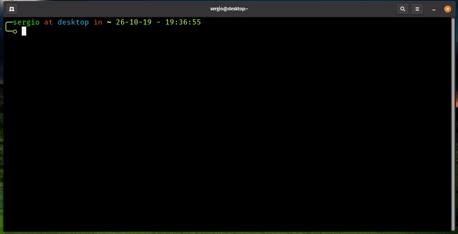

# WhoAmI

    

**WhoAmI** is a .NET 10 application for managing developer profiles, built as a portfolio project to demonstrate modern software architecture.

  

Get started with the application or explore its architecture using the documentation below.

---

## Explore the Project

### 🚀 Get Started

- [Quick Start](./docs/cli/quick-start.md) — Clone, build, and run the project.
- [Usage](./docs/cli/usage.md) — Learn the available commands.
- [Configuration](./docs/cli/configuration.md) — Customize the CLI.

### 🏛️ Understand the Architecture

- [Architecture](./docs/architecture/README.md) — Explains the application's architecture, layer responsibilities, design decisions, and dependency structure.
- [WhoAmI.Domain](./src/WhoAmI.Domain/README.md) — Defines the business model, entities, value objects, and domain events.
- [WhoAmI.Application](./src/WhoAmI.Application/README.md) — Implements application workflows, CQRS, validation, and the Result pattern.
- [WhoAmI.Infrastructure](./src/WhoAmI.Infrastructure/README.md) — Provides persistence, repositories, queries, and infrastructure services.
- [WhoAmI.Bootstrap](./src/WhoAmI.Bootstrap/README.md) — Configures dependency injection and application composition.

---

## Project Roadmap

| Category     | Scope                                                                                    |
|--------------|------------------------------------------------------------------------------------------|
| Interfaces   | ✅ Command-line interface ⏳ REST API ⏳ Web application ⏳ Desktop application |
| Features     | ✅ Profile management ⏳ Skills management                                            |
| Enhancements | ⏳ Pagination                                                                            |

> [!NOTE]
>
> **Legend:** ✅ Completed · ⏳ Planned

For detailed tracking of planned and completed work, see the GitHub Project:

[WhoAmI Development Roadmap](https://github.com/users/sergio-lopes-developer/projects/2)

Project development follows a transparent workflow using GitHub Issues, Milestones, Pull Requests, GitHub Projects, and GitHub Actions.

---

## License

This project is licensed under the MIT License.

If you find this project useful, you're welcome to use it as permitted by the license. If you build upon it, I'd appreciate proper attribution, although it is not required by the license.

---

Built with ❤️ on **Linux** using **JetBrains Rider**.

> *“Be not overcome of evil, but overcome evil with good.”*
>
> — **Romans 12:21**
