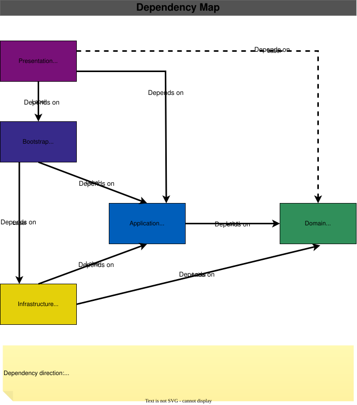

# Architecture

[🏠 Home](../../README.md) / **Architecture**

---

## Introduction

This document provides a high-level overview of the architecture used by the **WhoAmI** project.

Rather than explaining concepts such as [**Domain-Driven Design (DDD)**](https://www.domainlanguage.com/), [**Clean Architecture**](https://blog.cleancoder.com/uncle-bob/2012/08/13/the-clean-architecture.html), or [**Command Query Responsibility Segregation (CQRS)**](https://martinfowler.com/bliki/CQRS.html), this document explains how those principles are applied throughout the solution.

For implementation details of individual projects, see the [related documentation](#related-documentation) at the end of this document.

---

## Architectural Goals

The architecture aims to:

- Keep business rules independent of frameworks and infrastructure.
- Separate application workflows from domain logic.
- Isolate technical concerns.
- Support multiple presentation layers.
- Encourage maintainability and testability.
- Keep dependencies pointing toward the core business model.

---

## Architectural Overview

The solution is organized around the principles of Clean Architecture.

<p align="center">
    
</p>

> [!IMPORTANT]
>
> The Presentation layer has a limited direct dependency on the Domain layer solely for defensive handling of `DomainException`.
> 
> Except for the limited dependency described above, dependencies always point toward the Domain, which contains the core business model.

The solution is organized into five architectural layers:

- [Domain](#domain)
- [Application](#application)
- [Infrastructure](#infrastructure)
- [Bootstrap](#bootstrap)
- [Presentation](#presentation)

Each layer has a single responsibility and depends only on lower-level layers, keeping business rules independent of infrastructure and presentation technologies.

Detailed responsibilities for each layer are described in the following section.

---

## Architectural Decisions

Several architectural decisions intentionally shape the project:

- **Commands and Queries**  
  Commands modify state, while queries retrieve information. Keeping them separate simplifies reasoning about business operations.

- **Domain-Centric Design**  
  Business rules are always enforced by the Domain. The Application coordinates use cases but does not own business behavior.

- **Multiple Presentation Layers**  
  The architecture allows different user interfaces to reuse the same Application and Domain logic. This avoids duplication while keeping user interface concerns isolated.

---

## Layer Responsibilities

### Domain

The Domain layer represents the business itself.

It owns:

- Business rules.
- Aggregates.
- Entities.
- Value objects.
- Domain events.
- Domain exceptions.

The Domain never depends on higher layers.

### Application

The Application layer coordinates use cases.

It defines application workflows while remaining independent of persistence, presentation frameworks, and infrastructure implementations.

Business rules remain inside the Domain.

### Infrastructure

The Infrastructure layer provides technical implementations required by the Application.

Responsibilities typically include:

- Persistence.
- Repositories.
- Entity Framework Core configuration.
- Dapper query implementations.
- External services.

Infrastructure depends on the Application and Domain layers, never the opposite.

### Bootstrap

The Bootstrap layer acts as the application's composition root.

Its responsibility is to configure the application by:

- Registering dependency injection services.
- Wiring together Application and Infrastructure implementations.
- Configuring external frameworks and libraries.
- Providing a single composition root for presentation projects.

Presentation projects use the Bootstrap layer to initialize the application without containing dependency injection or infrastructure configuration themselves.

### Presentation

Presentation projects expose the application to users.

They translate user input into application requests and present the results returned by the Application layer.

The architecture supports multiple presentation layers, including:

- Command-line interface.
- REST API.
- Web application.
- Desktop application.

Each presentation layer can be introduced independently without changing the responsibilities of the existing layers.

---

## Repository Structure

```text
whoami/
├── docs/
├── src/
│   ├── WhoAmI.Application/
│   ├── WhoAmI.Bootstrap/
│   ├── WhoAmI.CLI/
│   ├── WhoAmI.Domain/
│   └── WhoAmI.Infrastructure/
└── tests/
    ├── WhoAmI.Application.Tests/
    ├── WhoAmI.CLI.Tests/
    ├── WhoAmI.Domain.Tests/
    ├── WhoAmI.Infrastructure.Tests/
    ├── WhoAmI.IntegrationTests/
    └── WhoAmI.Testing/
```

The repository is organized into three top-level directories. The `src/` directory contains the application projects that implement the architectural layers described above, while `docs/` contains project documentation and `tests/` contains the test projects that validate the solution.

- **`docs/`** — Project documentation, including architecture, design decisions, diagrams, and development guides.
- **`src/`** — Application source code. Each project has a single architectural responsibility following the principles of Clean Architecture.
  - **`src/WhoAmI.Domain/`** — Domain model, business rules, entities, value objects, and aggregates.
  - **`src/WhoAmI.Application/`** — CQRS, use cases, validation, command handlers, and application services.
  - **`src/WhoAmI.Infrastructure/`** — EF Core, repositories, query handlers, Dapper, database access, and infrastructure services.
  - **`src/WhoAmI.Bootstrap/`** — Composition root and dependency injection configuration.
  - **`src/WhoAmI.CLI/`** — Command-line interface and command implementations.
- **`tests/`** — Unit tests, integration tests, and shared testing utilities.

---

## Related Documentation

- [Project Overview](../../README.md) — Introduces the project, demonstrates its functionality, and outlines its roadmap.
- [WhoAmI.Domain](../../src/WhoAmI.Domain/README.md) — Defines the business model, entities, value objects, and domain events.
- [WhoAmI.Application](../../src/WhoAmI.Application/README.md) — Implements application workflows, CQRS, validation, and the Result pattern.
- [WhoAmI.Infrastructure](../../src/WhoAmI.Infrastructure/README.md) — Provides persistence, repositories, queries, and infrastructure services.
- [WhoAmI.Bootstrap](../../src/WhoAmI.Bootstrap/README.md) — Configures dependency injection and application composition.
- [WhoAmI.CLI](../../src/WhoAmI.CLI/README.md) — Implements the application's command-line interface.

---

## References

- [Domain-Driven Design](https://www.domainlanguage.com/) — Eric Evans
- [Clean Architecture](https://blog.cleancoder.com/uncle-bob/2012/08/13/the-clean-architecture.html) — Robert C. Martin
- [CQRS](https://martinfowler.com/bliki/CQRS.html) — Martin Fowler

---

Built with ❤️ on **Linux** using **JetBrains Rider**.

> *“Trust in the Lord with all your heart and lean not on your own understanding;”*
>
> — **Proverbs 3:5**
